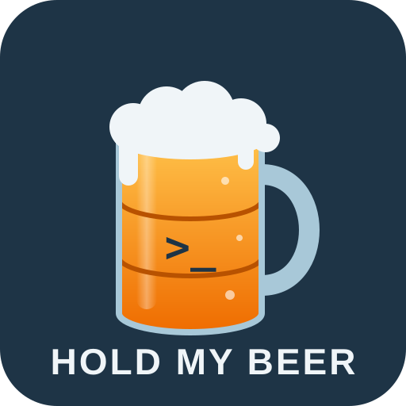

# Hold my beer

Oracle live, with AI. The audience picks the task by QR-code vote or random draw, two DBAs and their AI tools
(Claude Code, Codex, GitHub Copilot, ChatGPT, Microsoft Copilot) deliver - live, no safety net. What works, what
the AI hallucinates, and where decades of DBA experience still win.

By Stefan Oehrli and Martin Berger. First run: DOAG Anwenderkonferenz 2026, Nuernberg, "Denn sie wissen nicht was
sie tun - Oracle live mit Oehrli, Berger und KI".

Status: public since the talk (DOAG 2026-11-17). Nothing customer-related and no credentials in here.

## Layout

| Path | Content | Owner |
|------|---------|-------|
| `app/` | voting web app (Flask, SQLite), imported from Martin's `dswnwst` with history | Martin |
| `pool/` | topic pool per event (`<event>.yaml`) - single source for app seed and round slides | both |
| `rounds/` | per topic: task, prompts, expected AI failures, solution, reset | both |
| `env/` | lab environment and reset script | both |
| `slides/` | frame slides: sources, round generator, built deck per event | Stefan |
| `docs/` | format, storyline, roles, rehearsal notes, [app - slides handover](docs/handover-app-slides.md) | both |
| `assets/` | logo and images | both |

Terminal recordings (fallback when the network fails) stay out of git - too large, kept on OneDrive.

## Voting App - Requirements

- **Attendee view (mobile)**: open via QR code, no login, no personal data; one vote per device and round
- **Two modes per round**: vote (3 options, about 60 s) or random draw from the topic pool
- **Projector view**: live result, animated random draw
- **Presenter control**: open / close a round, trigger the draw, reset - protected by an admin token
- **Public URL**: attendees use mobile data, not the conference WLAN
- **Load**: a few hundred devices in one room, short bursts
- **Fallback**: show of hands or a local random draw on the laptop

Decided: Flask + SQLite app ([`app/README.md`](app/README.md)), pool as YAML, QR delivered by the app
(`/qr.svg`). Open: hosting and domain, random draw from the pool on the projector (the app has voting plus a
"Zufallsthema für mich" button that votes a random option; a pool draw is the admin's manual choice or a
reserve topic).

## License

Apache License 2.0 - see [LICENSE](LICENSE).
